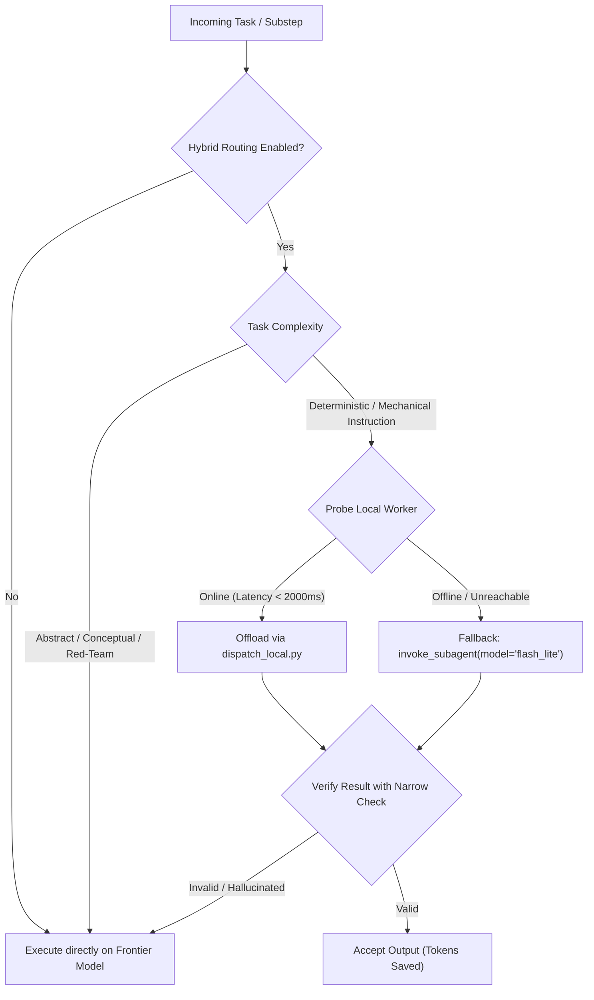

# Hybrid Routing (Adaptive Cognitive Workload Partitioning)

The context window and token quota on frontier models (e.g. Gemini Pro, Argon, Claude 3.7 Sonnet) are high-value resources. Spending frontier tokens on mechanical boilerplate, file slicing, lint fixing, or syntax translations burns budget without cognitive benefit. Conversely, asking smaller local models (e.g., Qwen 27B, local llama-server) to solve abstract architecture or subtle concurrency bugs produces hallucinations.

**Hybrid Routing** partitions work dynamically based on cognitive complexity.

> [!NOTE]
> This skill is **developmental** and feature-flagged. It can be toggled ON or OFF at any time.

---

## 1. Feature Flag & State Toggle

Hybrid routing status is stored in `~/.gemini/config/hybrid-routing.json`.

```bash
# Check current routing status & probe local worker
bash ~/.gemini/config/skills/hybrid-routing/scripts/toggle.sh status

# Enable hybrid routing (activates local worker offloading)
bash ~/.gemini/config/skills/hybrid-routing/scripts/toggle.sh on

# Disable hybrid routing (forces 100% frontier execution)
bash ~/.gemini/config/skills/hybrid-routing/scripts/toggle.sh off

# Point to custom local/LAN worker endpoint
bash ~/.gemini/config/skills/hybrid-routing/scripts/toggle.sh set-endpoint http://10.4.100.102:8080/v1
```

When **DISABLED**, the agent bypasses all local routing logic and operates purely on the host model without extra overhead.

---

## 2. Cognitive Workload Taxonomy

Before executing any non-trivial multi-step subtask, classify each step:

| Tier | Category | Examples | Target Model |
|---|---|---|---|
| **Tier 1: Abstract / Conceptual** | System Architecture | Designing module boundaries, seams, ports/adapters, domain modeling | **Frontier Model** (`pro`, `inherit`, Argon) |
| **Tier 1: Abstract / Conceptual** | Pre-Implementation Red-Teaming | Attacking hidden assumptions, blast radius, failure modes (`skeptic`) | **Frontier Model** (`pro`) |
| **Tier 1: Abstract / Conceptual** | Deep Debugging & Root Cause | Race conditions, memory leaks, subtle off-by-one errors, DSL2 topological DAG flows | **Frontier Model** (`pro`, `inherit`) |
| **Tier 1: Abstract / Conceptual** | Critical Code Review | Semantic correctness, security vulnerabilities, API invariants (`reviewer`) | **Frontier Model** (`pro`) |
| **Tier 2: Deterministic / Instruction** | Mechanical Edits | Lint fixes, adding missing imports, docstring additions, formatting | **Local Worker** or `flash_lite` subagent |
| **Tier 2: Deterministic / Instruction** | Transformation & Scaffolding | JSON to YAML/TS conversion, boilerplate CRUD, regex data parsing | **Local Worker** (`dispatch_local.py`) |
| **Tier 2: Deterministic / Instruction** | Search & Slicing | File scanning, counting occurrences, extracting structured line slices | **Local Worker** / Local CLI |
| **Tier 2: Deterministic / Instruction** | Test Suite Execution | Running pytest, npm test, cargo test and summarizing raw logs | **Local Worker** / Bash Tool |

---

## 3. Execution Protocol



### Step 1: Probe Local Worker Availability
Run the probe script:
```bash
~/.gemini/config/skills/hybrid-routing/scripts/probe_worker.sh
```
Probe checks in order:
1. Custom endpoint from `~/.gemini/config/hybrid-routing.json`
2. `http://localhost:8080/v1` (Local llama-server / vLLM)
3. `http://10.4.100.102:8080/v1` (LAN inference server / White-PC Strata)
4. `http://localhost:11434/v1` (Local Ollama)

### Step 2: Offload Deterministic Instruction Tasks
When local worker is online, dispatch the prompt:
```bash
python3 ~/.gemini/config/skills/hybrid-routing/scripts/dispatch_local.py \
  --prompt "Convert this JSON schema into a TypeScript interface: ..." \
  --max-tokens 1024
```

### Step 3: Safe Fallback Guarantee
- If the local worker returns exit code 2 (unreachable), immediately fall back:
  1. Option A: Use `invoke_subagent` with `Model: "flash_lite"`.
  2. Option B: Complete the step in the current frontier session.
- **Never stop or throw an error to the user** due to an offline local worker.

### Step 4: Verification Gate
Always execute the narrowest test command or syntax check (`python3 -m py_compile`, `npx tsc --noEmit`, `git diff`) before accepting local worker generated code.
