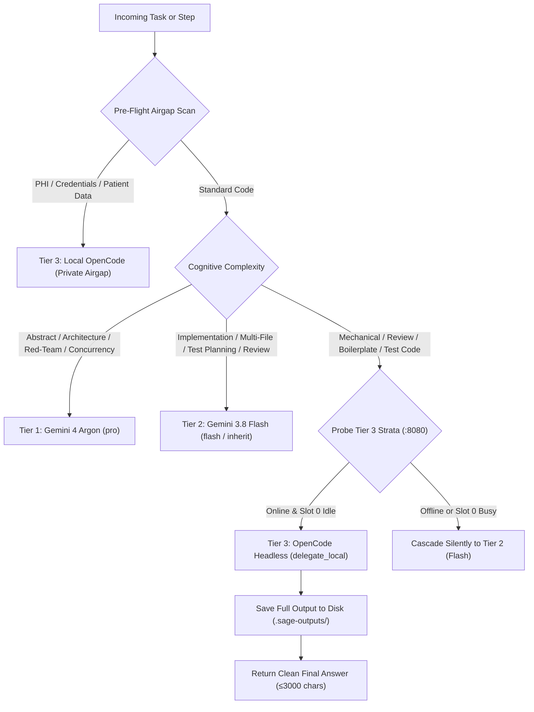

# Hybrid Routing (3-Tier Adaptive Cognitive Workload Partitioning)

Frontier models like **Gemini 4 Argon** excel at high-entropy conceptual reasoning, subtle architectural trade-offs, and adversarial stress-testing. Spending frontier tokens on mechanical boilerplate, syntax translation, or formatting burns token quota without cognitive value. Conversely, smaller local models produce hallucinations when asked to design deep architectures or trace complex race conditions.

**Hybrid Routing** partitions work across **3 cognitive tiers** dynamically without manual toggle overhead:

1. **Tier 1 (Frontier Reasoning):** Gemini 4 Argon (`Model: "pro"`, Argon High)
2. **Tier 2 (Fast Frontier Execution):** Gemini 3.8 Flash (`Model: "flash"`, `inherit`)
3. **Tier 3 (Local Instruction Worker):** Local OpenCode Harness (`Qwen 3.8 Flash Next` on Strata `:8080` with full tools, LSP, skills, and read-only reviewer isolation)

---

## 1. 3-Tier Cognitive Workload Taxonomy

| Tier | Engine / Model | Cognitive Profile | Workload & Task Scope |
|---|---|---|---|
| **Tier 1: Frontier / Conceptual** | **Gemini 4 Argon** (`pro`, Argon High) | High-entropy reasoning, deep conceptual synthesis | • System architecture, deep module interfaces, domain modeling<br>• Pre-implementation red-teaming (`skeptic` subagent)<br>• Non-deterministic root-cause debugging (race conditions, async concurrency, DAG flows)<br>• Critical security threat modeling & ADR trade-offs |
| **Tier 2: Fast Execution & Review** | **Gemini 3.8 Flash** (`flash`, `inherit`) | High-velocity balanced execution & agentic tooling | • Multi-file code implementation and targeted refactoring<br>• Unit & regression test suite authoring<br>• Code review of git working diffs (`reviewer` subagent)<br>• Active tool calling (Serena LSP navigation, command execution)<br>• Fast summarization & subagent coordination |
| **Tier 3: Local OpenCode Worker** | **Local OpenCode + Strata** (`Qwen 3.8 Flash Next` :8080) | Full-harness deterministic execution ($0 cloud tokens) | • Headless OpenCode execution (`opencode run`) with tools & LSP<br>• Cross-family code review via read-only `reviewer` agent (`edit: deny`)<br>• Unlimited local reasoning budget (tokens & time are free)<br>• Direct-to-disk test scaffolding (`delegate_local(output_path=...)`)<br>• Private sequencing/clinical files & local vision analysis |

---

## 2. Dynamic Routing Flowchart



---

## 3. Execution Protocols

### Primary Execution: `hybrid-sage` Native MCP Tools
When `hybrid-sage` MCP is mounted in your session, **always prefer native MCP tools**:

1. **Check Live Fleet & Slot-0 Telemetry**:
   Call `fleet_status({"discover_all": true})`.
   - If `slot_0_busy: false`, Strata is ready for instant execution without queuing.
   - If `slot_0_busy: true`, an OpenCode session is generating; cascade to Tier 2 or set `skip_if_busy: true`.

2. **OpenCode-First Execution (`delegate_local`)**:
   Drives OpenCode headless with full harness capabilities (tools, LSP, skills, reviewer isolation):
   - **Code Review (`mode="review"`)**: Runs read-only `reviewer` agent (`permission.edit: "deny"`). It reads files with its own tools and outputs structured findings without altering workspace files.
   - **Code / Tests (`mode="code"` / `mode="test"`)**: Runs `build` agent, optionally writing directly to `output_path` and running `verify_command`.
   - **Unlimited Local Budget**: Local tokens and reasoning time are free. No local output length truncation.
   - **Lean Cloud Return**: Saves full output to local disk, returning only the clean final answer (capped at 3000 chars preview) with `full_output_path`.
   - **Async Background Execution**: For long jobs, pass `async_mode=True`. Returns `job_id` immediately. Poll status using `delegate_local(job_id=...)`.

   ```json
   delegate_local({
     "prompt": "Audit src/parser.py for boundary condition flaws",
     "files": ["src/parser.py"],
     "mode": "review",
     "skip_if_busy": true
   })
   ```

3. **Pre-Flight Airgap & Task Classification**:
   - `route_task({"prompt": "...", "files": [...]})`: Multi-axis classification.
   - `airgap_scan({"text": "...", "files": [...]})`: Scans for secrets, API keys, or clinical PHI.

---

### Fallback Execution: CLI Scripts
If running in an older session where `hybrid-sage` MCP is not yet loaded into tool schemas:

1. **Probe Local Worker**:
   ```bash
   bash ~/.gemini/config/skills/hybrid-routing/scripts/probe_worker.sh
   ```

2. **Dispatch with OpenCode-First Execution**:
   ```bash
   python3 ~/.gemini/config/skills/hybrid-routing/scripts/dispatch_local.py \
     --prompt "Review src/parser.py concisely" \
     --output-path tests/test_parser.py
   ```
   If worker is offline or busy, it exits with code `2`: cascade silently to Tier 2 (Gemini 3.8 Flash). Never block user execution.
