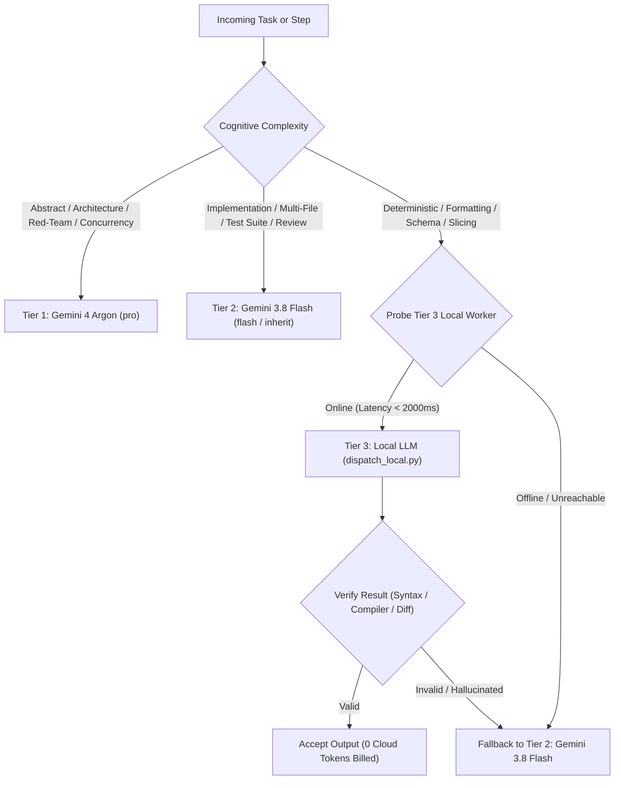

# Hybrid Routing (3-Tier Adaptive Cognitive Workload Partitioning)

Frontier models like **Gemini 4 Argon** excel at high-entropy conceptual reasoning, subtle architectural trade-offs, and adversarial stress-testing. Spending frontier tokens on mechanical boilerplate, syntax translation, or formatting burns token quota without cognitive value. Conversely, smaller local models produce hallucinations when asked to design deep architectures or trace complex race conditions.

**Hybrid Routing** partitions work across **3 cognitive tiers** dynamically without manual toggle overhead:

1. **Tier 1 (Frontier Reasoning):** Gemini 4 Argon (`pro` / `argon`)
2. **Tier 2 (Fast Frontier Execution):** Gemini 3.8 Flash (`flash` / `inherit`)
3. **Tier 3 (Local Instruction Worker):** Local Model (llama-server / vLLM / Ollama / LAN Strata at `http://10.4.100.102:8080/v1` or `localhost:8080`)

---

## 1. 3-Tier Cognitive Workload Taxonomy

| Tier | Engine / Model | Cognitive Profile | Workload & Task Scope |
|---|---|---|---|
| **Tier 1: Frontier / Conceptual** | **Gemini 4 Argon** (`pro`, Argon) | High-entropy reasoning, deep conceptual synthesis | • System architecture, deep module interfaces, domain modeling<br>• Pre-implementation red-teaming (`skeptic` subagent)<br>• Non-deterministic root-cause debugging (race conditions, async concurrency, DAG flows)<br>• Critical security threat modeling & ADR trade-offs |
| **Tier 2: Fast Execution & Review** | **Gemini 3.8 Flash** (`flash`, `inherit`) | High-velocity balanced execution & agentic tooling | • Multi-file code implementation and targeted refactoring<br>• Unit & regression test suite authoring<br>• Code review of git working diffs (`reviewer` subagent)<br>• Active tool calling (Serena LSP navigation, command execution)<br>• Fast summarization & subagent coordination |
| **Tier 3: Local Worker / Mechanical** | **Local Model** (`dispatch_local.py`, Qwen 27B, llama-server) | Deterministic instruction following (0 cloud tokens) | • Lint error fixes, formatting, import sorting<br>• Data schema conversions (JSON to TS/YAML/Pydantic/Proto)<br>• Repetitive boilerplate scaffolding & mock data fixtures<br>• Regex slicing, line counting, file structure summaries<br>• Raw compiler/test failure log parsing and truncation |

---

## 2. Dynamic Routing Flowchart



---

## 3. Activation via `/hybrid`

Whenever `/hybrid` is called or this skill is active, execute the following protocol:

### Step 1: Probe Local Worker Availability
Run the probe script:
```bash
bash ~/.gemini/config/skills/hybrid-routing/scripts/probe_worker.sh
```
The probe scans:
1. `LOCAL_LLM_ENDPOINT` environment variable (if exported)
2. `http://localhost:8080/v1` (Local llama-server / vLLM)
3. `http://10.4.100.102:8080/v1` (LAN inference server / Strata)
4. `http://localhost:11434/v1` (Local Ollama)

Output returns JSON status:
`{"available": true, "endpoint": "http://10.4.100.102:8080/v1", "model": "Qwen2.5-Coder-27B-Instruct", "latency_ms": 42}`

### Step 2: Workload Partitioning & Dispatch
- **For Abstract Reasoning / Red-Teaming**:
  Invoke subagents with `Model: "pro"` (e.g. `invoke_subagent(Role="Skeptic", Model="pro", ...)`).
- **For Standard Implementation & Review**:
  Execute directly in current session (Flash) or invoke subagent with `Model: "flash"`.
- **For Mechanical / Deterministic Work**:
  If Tier 3 is online:
  ```bash
  python3 ~/.gemini/config/skills/hybrid-routing/scripts/dispatch_local.py \
    --prompt "Format and add type annotations to this interface: ..." \
    --max-tokens 1024
  ```
  If Tier 3 returns exit code `2` (worker offline), **cascade silently to Tier 2 (Gemini 3.8 Flash)**. Never fail or block user work because a local model is offline.

### Step 3: Narrow Verification Gate
Never accept raw local worker code without narrow verification:
- Python: `python3 -m py_compile <file>`
- TypeScript: `npx tsc --noEmit`
- JSON/YAML: `python3 -m json.tool <file>` or `yamllint`
- Diffs: `git diff --stat`
